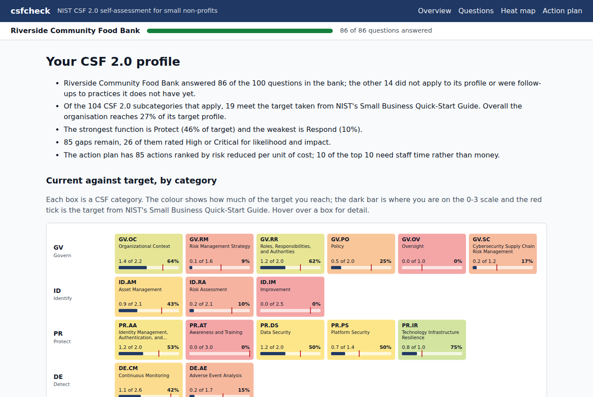

# csfcheck: a NIST CSF 2.0 self-assessment for small non-profits

csfcheck is a cybersecurity self-assessment for small charities, food banks and student societies, scored against NIST CSF 2.0. Formal risk assessments assume a security team and money for consultants, so small organisations mostly never do one ([this study of NGOs](https://www.emerald.com/insight/content/doi/10.1108/TG-08-2024-0201/full/html) found the same). I wanted something an office manager could finish alone in a browser, ending in a heat map, a ranked action plan, a Word report for the board and an Excel workbook an auditor can work from.

A single snapshot only goes so far, though. The real question a year later is "did the things we did make a difference?", and a board or funder asks it too. So an assessment can now be retaken. The new version starts from the old answers, the old version stays as it was, and the app shows what improved, what went backwards and which actions from the old plan are done.

It doesn't scan anything and it isn't a certification. It records what the organisation says it does, plus whatever evidence it offers.

## Running it

You need Python 3.11+ and PostgreSQL. PostgreSQL only has to be installed, not running. The tests and `serve --temp-db` start their own throwaway cluster and delete it when they stop.

```bash
python3 -m venv .venv
source .venv/bin/activate
pip install -e '.[dev]'

python3 -m pytest
python3 -m csfcheck serve --temp-db --port 23180
```

Then open http://127.0.0.1:23180/. The start page asks for the organisation's name and ten yes/no facts about it (do you have premises, take online donations, keep client records). After that the questions come one CSF function at a time, each with a line of plain-language help and an optional evidence box. There are no accounts. You get a resume code once, so you can carry on from another computer. At the end you land on the heat map, which links to the action plan, the Word report and the workbook.



The same scoring runs from the command line on an answers file, for example `python3 -m csfcheck export samples/food_bank.json -o out/food_bank.xlsx`, which writes the workbook and prints the top actions. Add `--previous` with an older answers file to get the Progress sheet:

```bash
python3 -m csfcheck export samples/retakes/food_bank.json --previous samples/food_bank.json -o out/food_bank_v2.xlsx
python3 -m csfcheck report samples/student_club.json -o out/student_club.docx
```

To run it with Docker instead (PostgreSQL and the app, nothing to install but Docker):

```bash
docker compose up --build --detach --wait
docker compose down -v
```

`scripts/compose-smoke.sh` does the same and takes a sample organisation through a retake over the API before tearing the stack down.

If you just want to look, [docs/samples/](docs/samples/) has a finished workbook and Word report for the food bank's second assessment.

Commands and flags: [docs/cli.md](docs/cli.md)
Web pages, the heat map and the Word report: [docs/web.md](docs/web.md)
JSON API with an example curl session: [docs/api.md](docs/api.md)
Docker Compose stack: [docs/docker.md](docs/docker.md)

## How it works

The CSF core is NIST's own JSON export from their Cybersecurity and Privacy Reference Tool, stored with its SHA-256, and the loader refuses a file that doesn't match. One surprise: the export still carries the withdrawn CSF 1.1 subcategories. Those have to be filtered out to get the 106 that are actually in CSF 2.0.

The 100 questions live in one YAML file, each mapped to one or more subcategories and answered on a 0 to 3 scale. The profile flags decide which questions apply, so a student club with no premises is never asked about door codes. Follow-ups only open when the parent question scored well enough. If you have no backups, you aren't asked whether you test them.

The fiddly part was making sure nothing falls through the gaps. At startup the bank is checked against all 1,024 combinations of flags, and every subcategory has to be either asked about or excluded with a reason, never both and never neither. A typo in a flag name or a mapping to an old 1.1 ID stops the app before it serves anything.

Targets come from NIST's Small Business Quick-Start Guide. The gap between current and target drives likelihood, impact goes up with things like holding donor data, and actions are ranked by how much risk they remove per unit of cost. The inherent numbers are my own coarse judgements for a small charity, kept in one file so they're easy to argue with. The rule I cared most about is that improving an answer can never raise a risk score. A Hypothesis property test checks it.

The three samples are made-up organisations. Here is the share of its target the food bank reaches in each function (a test keeps these figures honest):

| | Govern | Identify | Protect | Detect | Respond | Recover |
|---|---|---|---|---|---|---|
| Food bank | 33% | 19% | 46% | 30% | 10% | 11% |

Protect is its best function and Respond its worst. That fits what you'd guess: people turn on passwords and buy antivirus, but nobody has written down what to do on the day the donor database is encrypted.

## Retaking it

Each retake is a new version of the assessment, with its own profile and answers, linked to the one before and opened by the same resume code. `compare.py` lines two scored versions up subcategory by subcategory and reads the old action plan against the new scores. Each action is either completed (gap closed), progressed (gap smaller), still open, or no longer applicable. The web page, the Progress sheet, the report section and the API's `/compare` all come from that one function. A Hypothesis test checks that raising any set of answers never shows a regression or a new action.

`samples/retakes/food_bank.json` is the food bank a year on. It now enforces 2-step verification for everyone, has a two-page incident plan and has tested one restore, but the coordinator who looked after IT has left and one coordinator works from home. Against its first assessment (a test pins these too):

| | First | Second |
|---|---|---|
| Share of target reached | 27% | 34% |
| Subcategories at target | 19 | 22 |
| Respond, share of target | 10% | 32% |
| Actions in the plan | 85 | 82 |

18 subcategories improved and 3 went backwards. 4 of the old plan's actions are done and 14 more moved forward. One of the regressions is the obvious one: nobody owns IT any more (GV.RR-02), which puts that action back in the plan. Another surprised me. Ticking "staff work from home" adds two questions about home devices that map to PR.DS-01, and they come in low, so data-at-rest drops from 1.00 to 0.75 without anything getting worse in the office. Telling "you got worse" apart from "we're now asking about more of your organisation" would need another column.


Scoring and risk model: [docs/scoring.md](docs/scoring.md)
Question bank format and profile flags: [docs/question-bank.md](docs/question-bank.md)
Workbook sheets and columns: [docs/workbook.md](docs/workbook.md)
Data sources and licences: [docs/data-sources.md](docs/data-sources.md)

## Known issues and next steps

- The likelihood and impact numbers are judgement, not data. Two people could set them differently, though the ranking depends far more on gap size and cost band.
- The action plan is long, one action per gap (85 for the food bank). Grouping related ones, all the incident-response actions say, into a single task would make it much easier to read.
- Answers are averaged per subcategory, so a strong answer can hide a weak one. Taking the minimum would be stricter, but harsher on small organisations.
- The Word report has no heat map image, only a shaded category table, because python-docx can't embed SVG. For the same reason the progress section is a table, not a before-and-after heat map.
- A retake compares with the version it was retaken from. Comparing version 3 with version 1 works through the API (`?with=`), but the pages and the workbook only show the last step. A trend chart across all versions would be the natural next thing.
- When the profile changes, newly asked questions are averaged into subcategories that were already scored, as with PR.DS-01 above. That reads as a regression in the comparison.
- The resume code is the only access control, and it now opens every version. Losing it means losing the history. Anyone who has it can see all of it.
- The Compose file is meant for one machine: a default database password, no TLS, ports bound to localhost.

Project period: 2026-09-08 to 2026-09-17.
