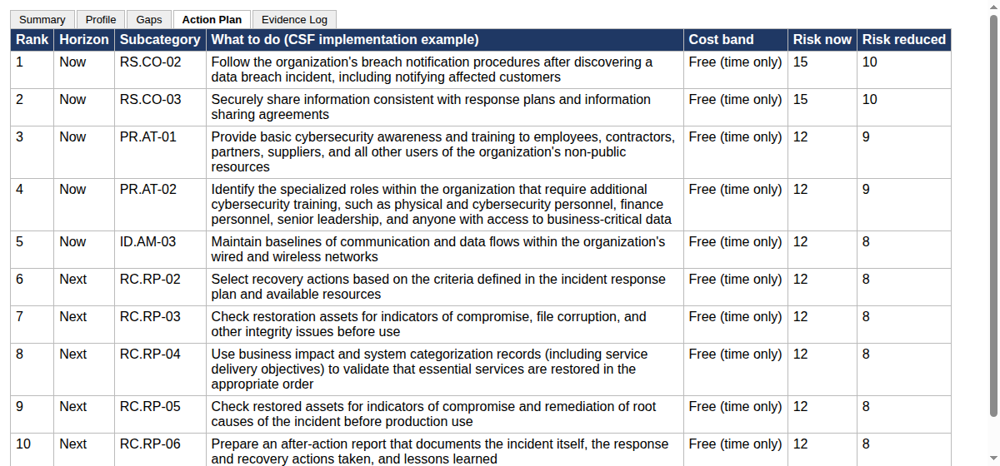

# csfcheck: a NIST CSF 2.0 self-assessment for small non-profits

csfcheck is a guided cybersecurity self-assessment for small charities, food banks and student societies, scored against NIST CSF 2.0. Formal risk assessments assume a security team, written processes and a budget for consultants, so in small organisations they often never happen, even when a funder starts asking what they do to protect client data. I wanted something an office manager could finish alone, ending in a ranked action plan and an Excel workbook an auditor can work from.

It doesn't scan anything and it isn't a certification. It records what the organisation says it does and the evidence it offers.

## Running it

You need Python 3.11+ and PostgreSQL. PostgreSQL only has to be installed, not running, because the tests and `serve --temp-db` start their own throwaway cluster.

```bash
python3 -m venv .venv
source .venv/bin/activate
pip install -e '.[dev]'

python3 -m pytest                      # 51 tests, including the PostgreSQL and API ones
python3 -m csfcheck check              # checksum, catalog counts, bank coverage
python3 -m csfcheck export samples/food_bank.json -o out/food_bank.xlsx
python3 -m csfcheck stats samples/*.json
```

`export` prints a summary and the top five actions:

```
Riverside Community Food Bank: asked 86 of 100 questions (14.0% skipped), 104 subcategories assessed, 85 actions
   1. RS.CO-02  High     free   Follow the organization's breach notification procedures after discovering a dat
   2. RS.CO-03  High     free   Securely share information consistent with response plans and information sharin
   3. PR.AT-01  High     free   Provide basic cybersecurity awareness and training to employees, contractors, pa
   4. PR.AT-02  High     free   Identify the specialized roles within the organization that require additional c
   5. ID.AM-03  High     free   Maintain baselines of communication and data flows within the organization's wir
wrote out/food_bank.xlsx
```



There is also an API for running an assessment question by question. `python3 -m csfcheck serve --temp-db --port 23180` starts it against a throwaway database that is deleted again on Ctrl-C.

API endpoints and an example curl session: [docs/api.md](docs/api.md)

## How it works

The CSF core is NIST's own JSON export from their Cybersecurity and Privacy Reference Tool, with its SHA-256 stored next to it. The loader refuses a file that doesn't match. One surprise was that the export still carries the withdrawn CSF 1.1 subcategories, so those have to be filtered out before you get the 106 that are actually in CSF 2.0.

The questions live in one YAML file: 100 of them, in plain language, each mapped to one or more subcategories and answered on a 0 to 3 scale. Ten profile flags (has_office, holds_client_data and so on) decide which questions apply, so a student club with no premises is never asked about door codes. Follow-ups only open when the parent question scored well enough. If you have no backups, you aren't asked whether you test them. Some subcategories just don't apply to some organisations, and each of those has an exclusion rule with a reason that ends up in the workbook. At startup the bank is checked against all 1,024 combinations of flags, and every subcategory has to be either asked about or excluded, never both and never neither. A typo in a flag name or a mapping to an old 1.1 ID stops the app before it serves anything.

Targets come from NIST's Small Business Quick-Start Guide. A subcategory the guide names directly gets target 3, one in a category it names gets 2, and the rest get 1. The gap between current and target drives the likelihood, each category has an impact that goes up with things like holding donor data, and actions are ranked by how much risk they remove per unit of cost. The inherent numbers are my own coarse judgements for a small charity, kept in one file so they're easy to argue with. The rule I cared most about is that improving an answer can never raise a risk score, and a Hypothesis property test checks it.

The three samples are made-up organisations: a food bank with client records, a student club running on members' laptops, and an arts charity with a NAS and online donations. On average 13% of the bank gets skipped. That's less than I expected. Most of the CSF is governance and incident handling, which applies however small you are.

Scoring and risk model: [docs/scoring.md](docs/scoring.md)
Question bank format and profile flags: [docs/question-bank.md](docs/question-bank.md)
Workbook sheets and columns: [docs/workbook.md](docs/workbook.md)
Data sources and licences: [docs/data-sources.md](docs/data-sources.md)

## Known issues and next steps

- The likelihood and impact numbers are judgement, not data. Two people could reasonably set them differently, although the ranking depends far more on gap size and cost band.
- The action plan is long, between 53 and 90 actions for the samples, one per gap. Grouping related ones (all the incident-response actions, say) into a single task would make it much easier to read.
- Answers are averaged per subcategory, so a strong answer can hide a weak one. Using the minimum would be stricter but harsher on small organisations.
- Next I want a web questionnaire so nobody needs curl, and a Word findings report to go with the workbook.

Project period: 2026-09-08 to 2026-09-11.
