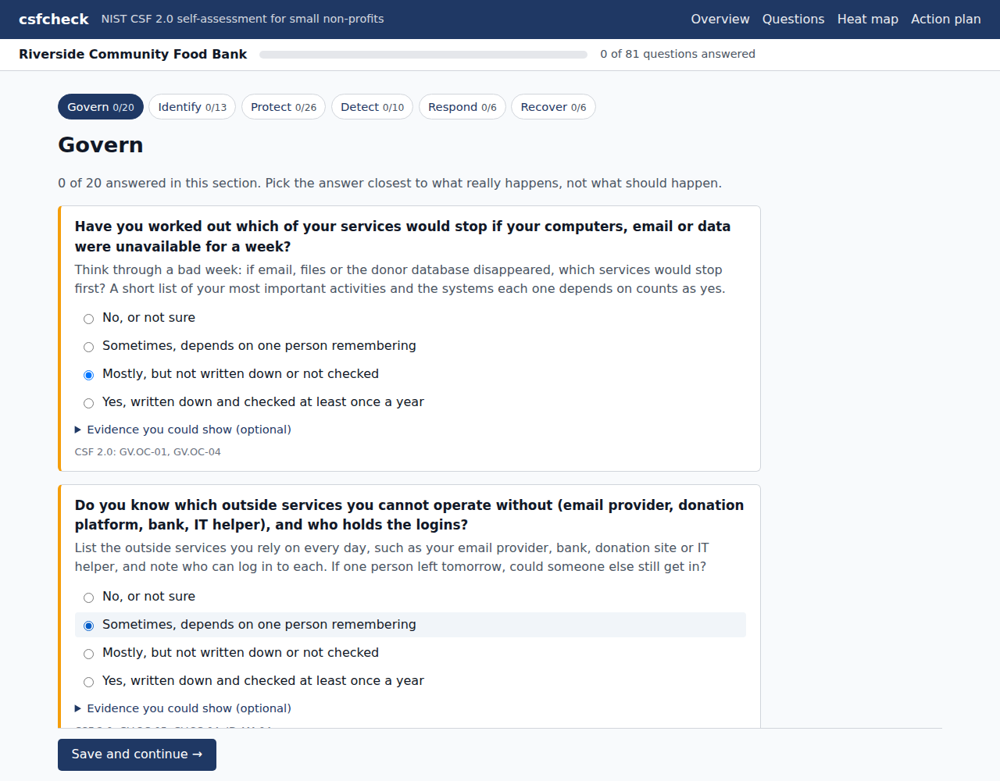
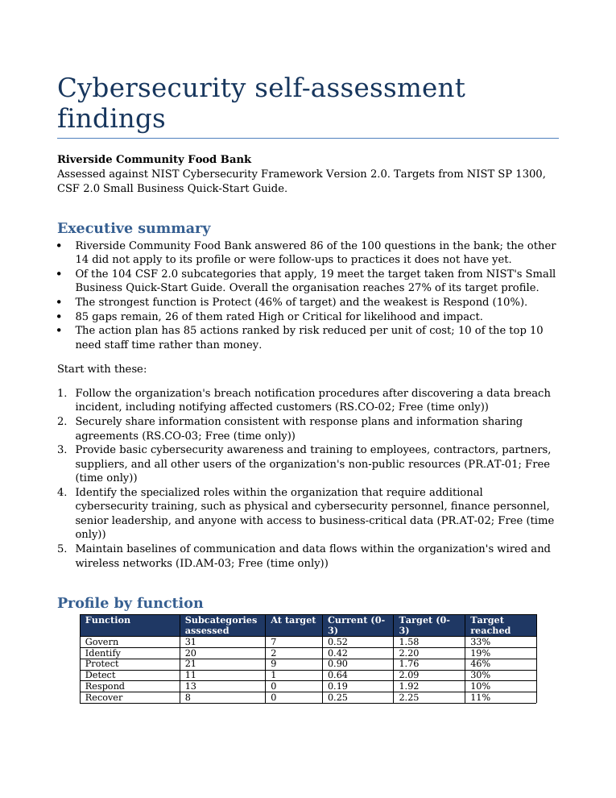

# csfcheck: a NIST CSF 2.0 self-assessment for small non-profits

csfcheck is a guided cybersecurity self-assessment for small charities, food banks and student societies, scored against NIST CSF 2.0. It is for the executive director, office manager or volunteer IT person who gets asked by a funder what they do to protect client data, and for the junior auditor who then has to check the answer. Formal risk assessments assume a security team, written processes and a budget for consultants, so in small organisations they often never happen ([this study of NGOs](https://www.emerald.com/insight/content/doi/10.1108/TG-08-2024-0201/full/html) found the same: no security staff, undocumented practices, tools priced for companies). I wanted something an office manager could finish alone in a browser, ending in a heat map of where they stand, a ranked action plan, a Word report for the board and an Excel workbook an auditor can work from.

It doesn't scan anything and it isn't a certification. It records what the organisation says it does and the evidence it offers.

## Running it

You need Python 3.11+ and PostgreSQL. PostgreSQL only has to be installed, not running, because the tests and `serve --temp-db` start their own throwaway cluster.

```bash
python3 -m venv .venv
source .venv/bin/activate
pip install -e '.[dev]'

python3 -m pytest                      # 77 tests, including the PostgreSQL, API and web ones
python3 -m csfcheck serve --temp-db --port 23180
```

Then open http://127.0.0.1:23180/. The start page asks for the organisation's name and ten yes/no facts about it (do you have premises, take online donations, keep client records...), and the questionnaire goes one CSF function at a time. Each question has a line of plain-language help under it and an optional box for the evidence you could show. Follow-ups appear on the same page once you answer the question they depend on, and the questions that don't apply are listed at the bottom with the reason. The progress bar counts only the questions that apply to you. The throwaway database is deleted again when the server stops.



When you finish you land on the heat map: one row per CSF function, one box per category, coloured by how much of the target you reach, with a bar for current against target. The SVG is drawn on the server, so it works without JavaScript and the page is just HTML.


The action plan page lists every gap in rank order, and both pages link to the Word report and the Excel workbook. Starting an assessment sets its token in a cookie for that assessment's pages and shows a resume code once, so you can carry on from another computer. There are no accounts.

Everything also works from the command line on an answers file:

```bash
python3 -m csfcheck check              # checksum, catalog counts, bank coverage
python3 -m csfcheck export samples/food_bank.json -o out/food_bank.xlsx
python3 -m csfcheck report samples/student_club.json -o out/student_club.docx
python3 -m csfcheck stats samples/*.json
```

`export` prints a summary and the top five actions:

```
Riverside Community Food Bank: asked 86 of 100 questions (14.0% skipped), 104 subcategories assessed, 85 actions
   1. RS.CO-02  High     free   Follow the organization's breach notification procedures after discovering a dat
   2. RS.CO-03  High     free   Securely share information consistent with response plans and information sharin
   3. PR.AT-01  High     free   Provide basic cybersecurity awareness and training to employees, contractors, pa
   4. PR.AT-02  High     free   Identify the specialized roles within the organization that require additional c
   5. ID.AM-03  High     free   Maintain baselines of communication and data flows within the organization's wir
wrote out/food_bank.xlsx
```

and `report` writes the Word findings report:

```
Campus Robotics Society: 11 of 101 subcategories at target, 90 actions, top 10 in the report
wrote out/student_club.docx
```

The report opens with an executive summary written as sentences, then the profile by function and by category (shaded like the heat map), the top ten actions, the subcategories that don't apply and why, and a note on what a self-assessment can't tell you.



There is also a JSON API for running an assessment question by question, served by the same process. API endpoints and an example curl session: [docs/api.md](docs/api.md). The web pages: [docs/web.md](docs/web.md)

## How it works

The CSF core is NIST's own JSON export from their Cybersecurity and Privacy Reference Tool, with its SHA-256 stored next to it. The loader refuses a file that doesn't match. One surprise was that the export still carries the withdrawn CSF 1.1 subcategories, so those have to be filtered out before you get the 106 that are actually in CSF 2.0.

The questions live in one YAML file: 100 of them, in plain language, each mapped to one or more subcategories and answered on a 0 to 3 scale. Ten profile flags (has_office, holds_client_data and so on) decide which questions apply, so a student club with no premises is never asked about door codes. Follow-ups only open when the parent question scored well enough. If you have no backups, you aren't asked whether you test them. Some subcategories just don't apply to some organisations, and each of those has an exclusion rule with a reason that ends up in the workbook. At startup the bank is checked against all 1,024 combinations of flags, and every subcategory has to be either asked about or excluded, never both and never neither. A typo in a flag name or a mapping to an old 1.1 ID stops the app before it serves anything.

Targets come from NIST's Small Business Quick-Start Guide. A subcategory the guide names directly gets target 3, one in a category it names gets 2, and the rest get 1. The gap between current and target drives the likelihood, each category has an impact that goes up with things like holding donor data, and actions are ranked by how much risk they remove per unit of cost. The inherent numbers are my own coarse judgements for a small charity, kept in one file so they're easy to argue with. The rule I cared most about is that improving an answer can never raise a risk score, and a Hypothesis property test checks it.

The three samples are made-up organisations: a food bank with client records, a student club running on members' laptops, and an arts charity with a NAS and online donations. On average 13% of the bank gets skipped. That's less than I expected. Most of the CSF is governance and incident handling, which applies however small you are.

The heat map rolls the 106 subcategories up into the 22 categories. A category's colour is the share of its target reached (each subcategory counts up to its target, so overshooting one doesn't hide a gap in another), and excluded subcategories don't count. Rolled up by function, the samples look like this:

| Share of target reached | Govern | Identify | Protect | Detect | Respond | Recover | Overall |
|---|---|---|---|---|---|---|---|
| Food bank | 33% | 19% | 46% | 30% | 10% | 11% | 27% |
| Student club | 10% | 11% | 38% | 21% | 8% | 0% | 15% |
| Arts charity | 71% | 55% | 73% | 67% | 52% | 53% | 63% |

All three do best on Protect and worst on Respond or Recover. That matches what I'd expect from small organisations: people buy antivirus and turn on passwords, but nobody has written down what to do on the day the donor database is encrypted.

Scoring and risk model: [docs/scoring.md](docs/scoring.md)
Question bank format and profile flags: [docs/question-bank.md](docs/question-bank.md)
Workbook sheets and columns: [docs/workbook.md](docs/workbook.md)
Web pages, the heat map and the Word report: [docs/web.md](docs/web.md)
Data sources and licences: [docs/data-sources.md](docs/data-sources.md)

## Known issues and next steps

- The likelihood and impact numbers are judgement, not data. Two people could reasonably set them differently, although the ranking depends far more on gap size and cost band.
- The action plan is long, between 53 and 90 actions for the samples, one per gap. Grouping related ones (all the incident-response actions, say) into a single task would make it much easier to read.
- Answers are averaged per subcategory, so a strong answer can hide a weak one. Using the minimum would be stricter but harsher on small organisations.
- The web pages are plain forms with no JavaScript, so a follow-up only appears after you press Save. A little progressive enhancement would show it straight away.
- An answer can't be cleared once saved, only changed. That hasn't mattered with the samples, but someone who clicks by mistake has to pick the closest answer instead.
- The Word report has no heat map image, only the shaded category table. python-docx can't embed SVG, and I didn't want a rendering dependency just for that.
- Next I'd like to compare two assessments of the same organisation, so a charity can see a year's progress on the heat map.

Project period: 2026-09-08 to 2026-09-11.
