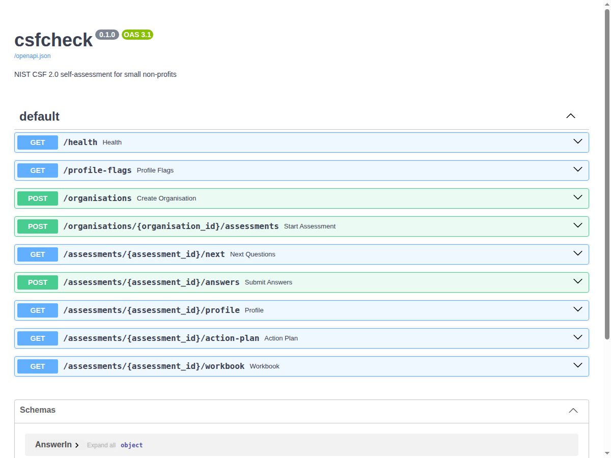

# API

The API is FastAPI on PostgreSQL. Interactive docs are at `/docs` once it is running. The same process serves the web questionnaire at `/` (see [web.md](web.md)).



## Starting it

Against a throwaway database (stopped and deleted on Ctrl-C):

```bash
python3 -m csfcheck serve --temp-db --port 23180
```

Against your own database:

```bash
export CSFCHECK_DATABASE_URL='postgresql+psycopg://user@localhost/csfcheck'
python3 -m csfcheck load-csf
python3 -m csfcheck serve
```

`load-csf` and `serve` also take `--database-url`. `serve` takes `--host` (default `127.0.0.1`) and `--port` (default 23180).

## Endpoints

- `GET /health`
- `GET /profile-flags`
- `POST /organisations`: name and profile flags
- `POST /organisations/{id}/assessments`: returns the assessment ID and its token
- `GET /assessments/{id}/next?limit=N`: the next unanswered questions
- `POST /assessments/{id}/answers`: answers, with optional evidence notes
- `GET /assessments/{id}/profile`: current vs target per subcategory
- `GET /assessments/{id}/action-plan?limit=N`
- `GET /assessments/{id}/workbook`: the Excel workbook, with a Progress sheet against the version it was retaken from
- `POST /assessments/{id}/retake`: start the next version. Optional body `{"profile": {...}, "copy_answers": true}`
- `GET /assessments/{id}/versions`: every version opened by this token, with its score
- `GET /assessments/{id}/compare?with=N`: what changed since version `N`, or since the version it was retaken from when `with` is left out

Everything under `/assessments` needs the `X-Assessment-Token` header.

## Example session

```bash
curl -s -X POST localhost:23180/organisations -H 'content-type: application/json' \
  -d '{"name":"Riverside Community Food Bank","profile":{"has_office":true,"uses_cloud_email":true,"holds_donor_data":true,"holds_client_data":true,"has_employees":true}}'
curl -s -X POST localhost:23180/organisations/1/assessments
# -> {"id":1,"token":"...","questions_for_profile":90}
curl -s 'localhost:23180/assessments/1/next?limit=2' -H "X-Assessment-Token: $TOKEN"
curl -s -X POST localhost:23180/assessments/1/answers -H "X-Assessment-Token: $TOKEN" \
  -H 'content-type: application/json' \
  -d '{"answers":[{"question_id":"gv-mission","value":"mostly"},{"question_id":"gv-dependencies","value":"informal","evidence":"List of logins kept by the coordinator"}]}'
curl -s 'localhost:23180/assessments/1/action-plan?limit=1' -H "X-Assessment-Token: $TOKEN"
curl -s localhost:23180/assessments/1/workbook -H "X-Assessment-Token: $TOKEN" -o assessment.xlsx

# A year later: retake with remote staff, starting from the old answers
curl -s -X POST localhost:23180/assessments/1/retake -H "X-Assessment-Token: $TOKEN" \
  -H 'content-type: application/json' -d '{"profile":{"has_office":true,"uses_cloud_email":true,"holds_donor_data":true,"holds_client_data":true,"has_employees":true,"remote_staff":true}}'
# -> {"id":2,"version":2,"previous_id":1,"answers_copied":86,"questions_for_profile":92}
curl -s localhost:23180/assessments/2/compare -H "X-Assessment-Token: $TOKEN"
```

`scripts/compose-smoke.sh` runs this session against the Docker Compose stack, with every answer filled in.

## Behaviour worth knowing

- The per-assessment token is the only access control. Only its SHA-256 is stored.
- Answering a question that the profile or an earlier answer skips returns 422.
- If you lower a parent answer, the follow-up answers it no longer allows are dropped.
- A retake keeps the token, so one token opens every version. A version can only be compared with another version of the same organisation that has the same token. Anything else is a 404.
- Each version keeps its own profile, so version 1 is still scored as it was after the organisation changes its flags in version 2.
- `next` returns questions in bank order and waits on a follow-up's parent, so it can return fewer than `limit` while answers are pending.
