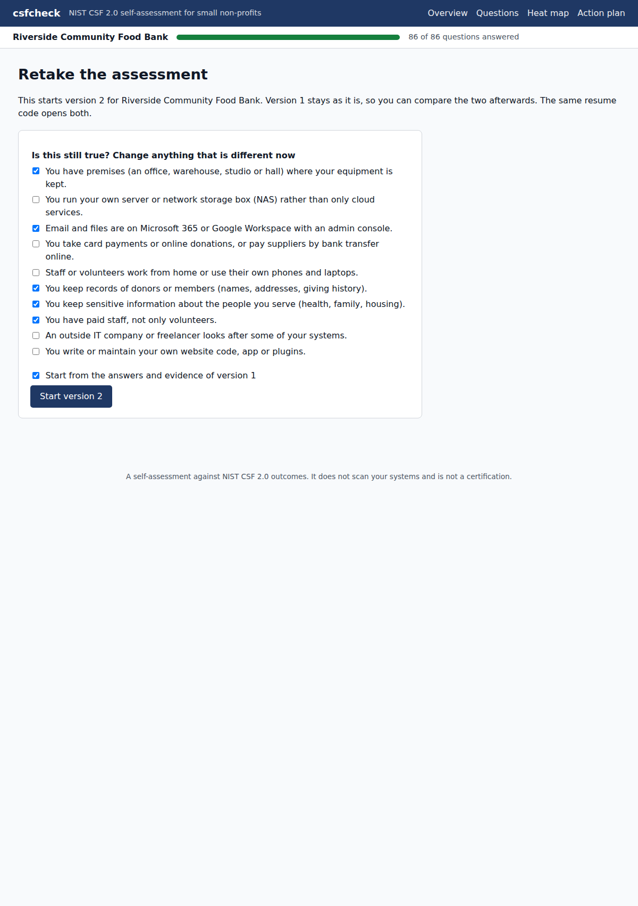
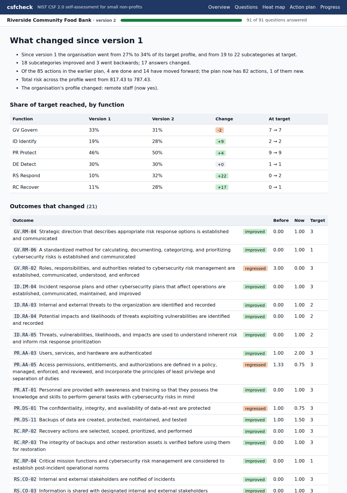
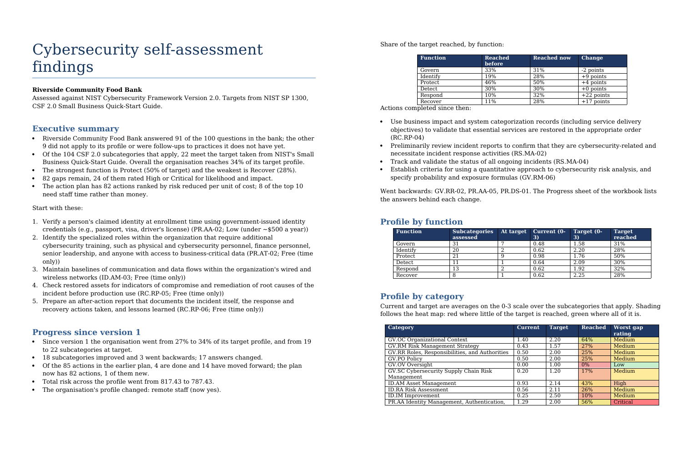
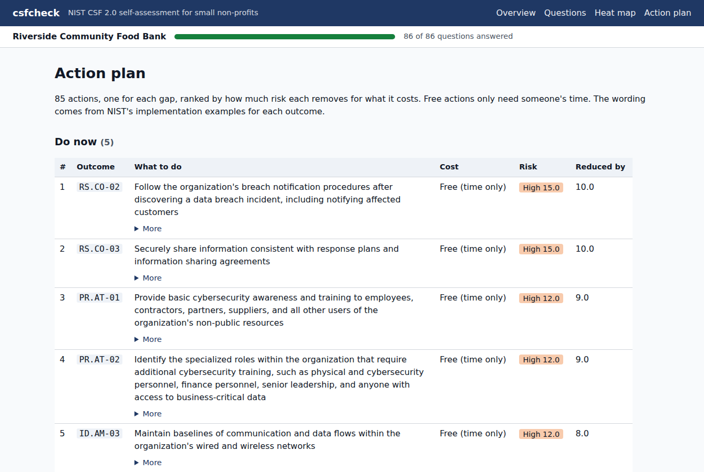
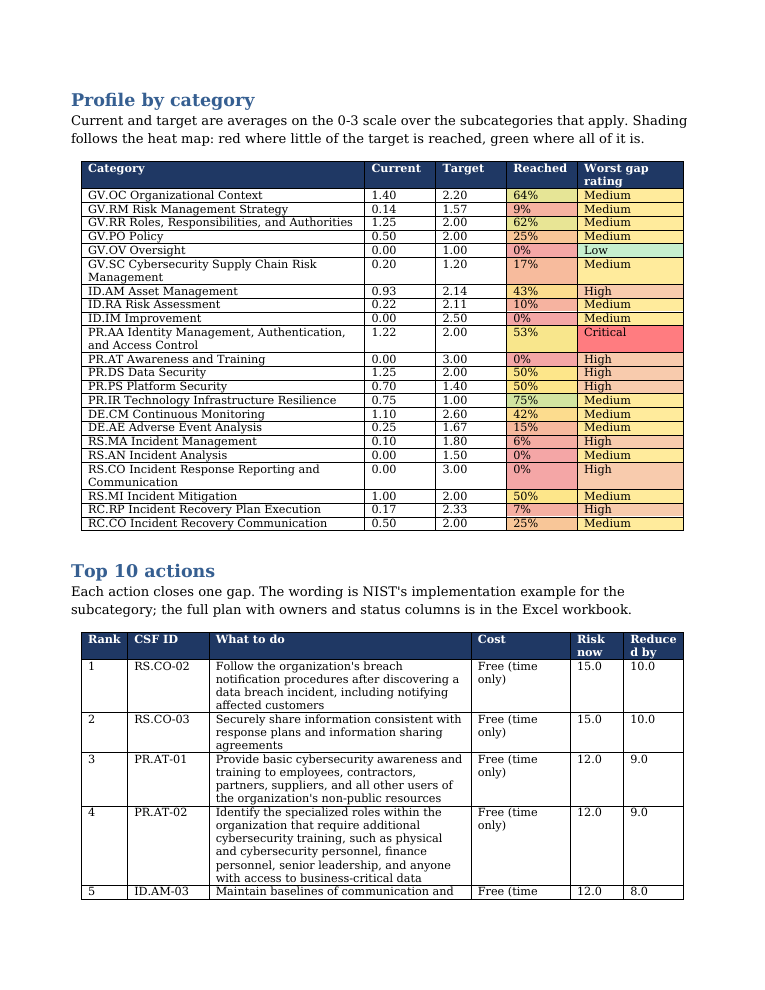

# Web pages, heat map and Word report

The pages are server-rendered with Jinja templates (`src/csfcheck/templates/`) and served by the same FastAPI app as the JSON API, so `python3 -m csfcheck serve` runs both. There is no JavaScript.

## Pages

| Path | What it shows |
|---|---|
| `/` | Start form (organisation name and the ten profile flags) and a resume form |
| `/a/{id}` | Overview: the profile you gave, each section's answered/asked count, links to the downloads |
| `/a/{id}/questions` | Redirects to the first section with unanswered questions, or to the heat map when there are none |
| `/a/{id}/s/{section}` | The questions for one CSF function, with help text, answer options and an evidence box |
| `/a/{id}/heatmap` | Executive summary, the SVG heat map and a table by function |
| `/a/{id}/heatmap.svg` | The heat map on its own |
| `/a/{id}/plan` | The ranked action plan grouped into Now (top 5), Next (6-15) and Later |
| `/a/{id}/report.docx` | Word findings report |
| `/a/{id}/workbook.xlsx` | The same Excel workbook as `csfcheck export` |
| `/a/{id}/retake` | Start the next version: confirm the profile flags and whether to copy the answers |
| `/a/{id}/progress` | What changed since the version this one was retaken from |

## Navigation

Sections are the six CSF functions in order. "Save and continue" saves the page and moves on to the next section that still has unanswered questions, skipping sections where nothing applies to the organisation. If the answers just saved opened a follow-up on the same page (backups answered "mostly" opens "have you tested a restore?"), the page comes back with the follow-up in place. "Save and go back" saves and goes to the previous section that has questions.

Until its parent is answered, a follow-up shows as a dashed placeholder. A question that isn't asked is listed at the bottom of the section with the reason: either the profile condition it depends on ("Only asked if: has office or has servers") or the earlier answer that closed it. Lowering a parent answer drops the follow-up answers it closes, the same as in the API.

You can leave questions blank and look at the results at any time. Unanswered questions count as 0 and the pages say the assessment isn't finished.

## The token

Starting an assessment creates a random token and stores only its SHA-256, as the API does. The browser gets the token in an HttpOnly, SameSite=Lax cookie whose path is that assessment's pages (`/a/{id}`). The overview shows it once as a resume code, and the resume form on the start page sets the cookie again in another browser. Without the cookie every assessment page is a 404. There are no user accounts.

## Retaking and progress

The overview has a "Retake the assessment" link. The retake page shows the profile flags as they are now, ticked, so the organisation can change anything that has changed (it started taking card payments, staff now work from home), and by default it copies the answers and evidence. The new version opens with a notice to go through each section and change what's different. Questions the new profile adds are left blank. Follow-ups stay closed until their parent answer goes up.

The earlier version is never touched. It keeps its own profile and answers, and the overview lists every version. The progress page and the Progress sheet in the workbook compare a version with the one it was retaken from. They show the share of the target reached per function, every subcategory that improved or went backwards, which of the old plan's actions are done or have moved forward, and the answers that changed. With `previous` given, the Word report gets a "Progress since version N" section.

## Heat map

`heatmap.py` draws the SVG. Rows are functions and boxes are categories. For each category, `rollup.py` takes the assessed subcategories (excluded ones don't count) and works out

- current and target: the mean over those subcategories, on the 0-3 scale
- target reached: `sum(min(current, target)) / sum(target)`, so a subcategory above its target can't make up for one below

The box colour runs from red (0% reached) through amber (50%) to green (100%), and grey means not applicable. The dark bar is current on the 0-3 scale and the red tick is the target. Hovering over a box shows how many subcategories are at target.

## Word report

`python3 -m csfcheck report <answers.json> -o <file.docx>` and `/a/{id}/report.docx` write the same document (python-docx):

1. Executive summary: questions answered, subcategories at target, the share of the target profile reached overall, the strongest and weakest function, how many gaps are rated High or Critical, and the first five actions.
2. Profile by function: assessed, at target, mean current, mean target, target reached.
3. Profile by category: the 22 categories with current, target, target reached (shaded like the heat map) and the worst rating among the category's gaps.
4. Top actions: rank, CSF ID, NIST's implementation example, cost band, risk now and risk reduced. `--top N` changes how many (default 10).
5. Not applicable: excluded subcategories grouped by the reason.
6. About this assessment: it is a self-assessment, nothing was scanned, it is not a certification, and how many answers came with evidence.

For a retake, a "Progress since ..." section follows the executive summary. It has the comparison in sentences, a table of target reached per function before and now, the actions completed and the subcategories that went backwards. A sample is in [samples/food_bank_v2.docx](samples/food_bank_v2.docx).

`report` exits 1 for an incomplete answers file unless `--allow-incomplete` is given, like `export`.

## Screenshots

The action plan page for the food bank sample:

The second page of the food bank's Word report, with the category table and the first actions:

