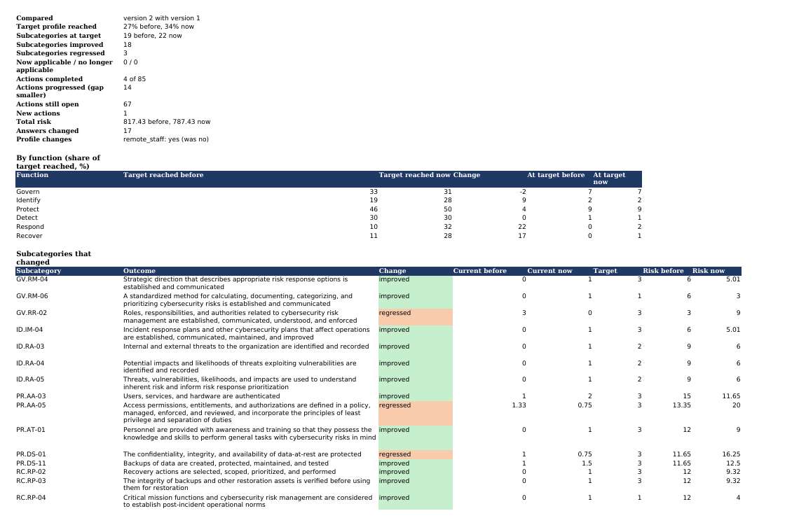

# Workbook

`python3 -m csfcheck export <answers.json> -o <file.xlsx>` and `GET /assessments/{id}/workbook` both write the same workbook.

CLI options for `export`: `--top N` sets how many actions are printed (default 5). `--allow-incomplete` makes it exit 0 even when some asked questions are unanswered. `--previous FILE` compares with an earlier answers file. The workbook downloaded from the API or the web pages compares with the version it was retaken from.

A finished example is in [samples/food_bank_v2.xlsx](samples/food_bank_v2.xlsx): the food bank's second assessment compared with its first.

## Sheets

- Summary: organisation, question counts and totals.
- Profile: one row per CSF 2.0 subcategory (106 rows). Columns: Function, Category, Subcategory, Outcome, Status, Current (0-3), Target (0-3), Gap, Target basis, Questions, Not applicable because.
- Gaps: assessed subcategories with a gap, highest risk first. Columns: Subcategory, Function, Outcome, Current, Target, Gap, Likelihood (1-5), Impact (1-5), Risk (1-25), Rating, Unanswered questions.
- Action Plan: one row per gap, in rank order. Columns: Rank, Horizon, Subcategory, What to do (CSF implementation example), Also consider, Quick-Start Guide action, Cost band, Risk now, Risk reduced, Reduction per cost unit, Example IDs, Owner, Status. Status has a dropdown.
- Evidence Log: one row per asked question. Columns: Question, Section, Question text, Answer, Score (0-3), Subcategories, Evidence offered, Auditor: evidence seen?, Auditor notes. The last two are left for the auditor.
- Progress: what changed since the earlier version. At the top is a summary: target profile reached before and now, subcategories improved and regressed, actions completed, progressed, still open and new, total risk, and any change to the profile flags. Below it come four tables:
  - By function: share of target reached before and now, the change in points, and subcategories at target.
  - Subcategories that changed: Subcategory, Outcome, Change, Current before, Current now, Target, Risk before, Risk now.
  - Actions from the earlier plan and new ones: Subcategory, Action, Status, Rank before, Rank now, Gap before, Gap now, Cost band. Completed ones come first. Actions still open with no change are counted at the top but not listed.
  - Answers that changed: Question, Question text, Answer before, Answer now, Section.

  On a first assessment the sheet says there is nothing to compare yet and shows the baseline by function.

